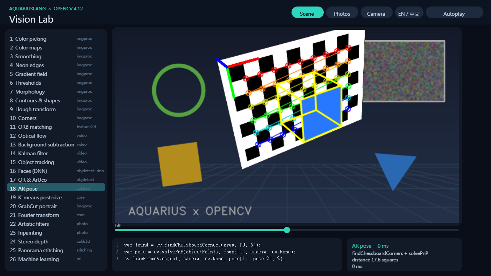
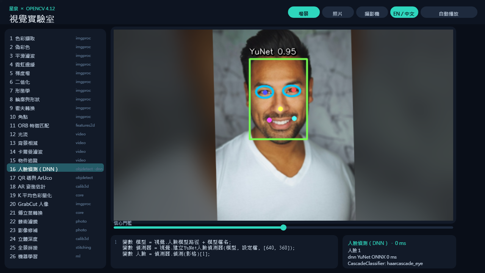
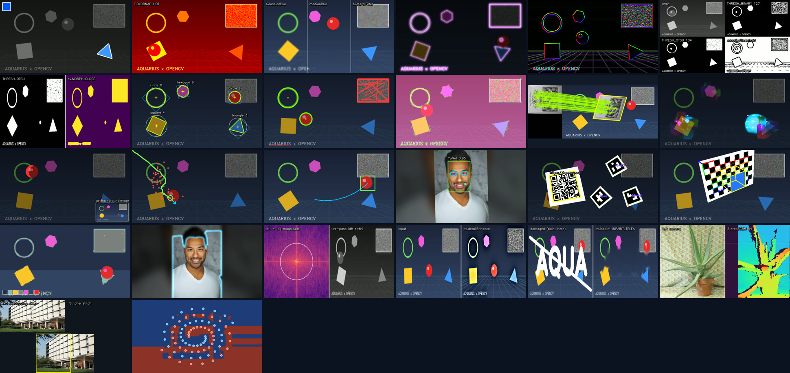

# Aqua × OpenCV Vision Lab · 星泉 × OpenCV 視覺實驗室

An interactive tour of OpenCV in AquariusLang: 26 live labs, each a few lines of real `cv` calls running on every
frame. It installs the library from this repository (`Aqua_OpenCV = { path = "../" }`).

以星泉體驗 OpenCV：26 個即時實驗室，每個都是在每一影格執行的真實 `cv` 呼叫。範例直接安裝上層資料夾的函式庫。





## Run · 執行

```powershell
aqua bottle install ../ --project .
aqua run .                                   # Windows / Linux desktop
aqua build . --target web -o web             # then serve web/ over http(s)
aqua build . --target android -o lab.apk
```

## Controls · 操作

| | |
| --- | --- |
| Click a lab, or ↑ / ↓ | switch lab 切換實驗室 |
| Drag the slider, mouse wheel, ← / → | the lab's knob (threshold, kernel, model, ...) 調整參數 |
| Scene · Photos · Camera (1 / 2 / 3) | live synthetic scene, sample photos (slowly panning), or a camera 影像來源 |
| EN / 中文 (L) | interface and code in English or 繁體中文 介面與程式碼語言 |
| Autoplay (A) | cycles through every lab 自動播放 · Space pauses 暫停 |

Labs that use the mouse: click to pick a color (1), drag a box to track anything (15), paint scratches to inpaint
(23, right-click clears) and click to add training points (26, left and right buttons are the two classes).

## The labs · 實驗室

| # | Lab | OpenCV |
| --- | --- | --- |
| 1 | Color picking 色彩擷取 | `cvtColor`, `inRange`, `findContours` |
| 2 | Color maps 偽彩色 | `applyColorMap` (22 palettes) |
| 3 | Smoothing 平滑濾波 | `GaussianBlur`, `medianBlur`, `bilateralFilter` |
| 4 | Neon edges 霓虹邊緣 | `Canny`, `dilate`, `merge`, `add` |
| 5 | Gradient field 梯度場 | `Sobel`, `cartToPolar`, HSV |
| 6 | Thresholds 二值化 | `threshold` (binary, Otsu), `adaptiveThreshold` |
| 7 | Morphology 形態學 | `morphologyEx` (7 operations) |
| 8 | Contours & shapes 輪廓與形狀 | `approxPolyDP`, `minAreaRect`, `minEnclosingCircle`, `moments` |
| 9 | Hough transform 霍夫轉換 | `HoughLinesP`, `HoughCircles` |
| 10 | Corners 角點 | `goodFeaturesToTrack`, `cornerHarris` |
| 11 | ORB matching 特徵匹配 | `ORB`, `BFMatcher.knnMatch`, `findHomography`, `perspectiveTransform`, `drawMatches` |
| 12 | Optical flow 光流 | `calcOpticalFlowFarneback` |
| 13 | Background subtraction 背景相減 | `BackgroundSubtractorMOG2` |
| 14 | Kalman filter 卡爾曼濾波 | `KalmanFilter` |
| 15 | Object tracking 物件追蹤 | `TrackerMIL` |
| 16 | Faces (DNN) 人臉偵測 | `FaceDetectorYN` (YuNet ONNX through `cv.dnn`), `CascadeClassifier` (eyes) |
| 17 | QR & ArUco | `QRCodeEncoder`, `QRCodeDetector`, `ArucoDetector`, `drawDetectedMarkers` |
| 18 | AR pose AR 姿態估計 | `findChessboardCorners`, `solvePnP`, `projectPoints`, `drawFrameAxes` |
| 19 | K-means posterize K 平均色彩量化 | `kmeans`, `LUT` |
| 20 | GrabCut portrait GrabCut 人像 | `grabCut`, `compare`, `bitwise_or` |
| 21 | Fourier transform 傅立葉轉換 | `dft`, `idft`, `magnitude` |
| 22 | Artistic filters 藝術濾鏡 | `stylization`, `pencilSketch`, `detailEnhance`, `edgePreservingFilter` |
| 23 | Inpainting 影像修補 | `inpaint` (Telea, Navier-Stokes) |
| 24 | Stereo depth 立體深度 | `StereoSGBM` |
| 25 | Panorama stitching 全景拼接 | `Stitcher` |
| 26 | Machine learning 機器學習 | `SVM`, `KNearest`, `RTrees`, `NormalBayesClassifier` |



## Files · 檔案

- `main.aqua`: the window, sources, layout and input (Processing).
- `labs.aqua`: the 26 labs and the code each one shows. Every Mat made for a frame goes through `T()` and is
  deleted after drawing, as OpenCV.js asks.
- `scene.aqua`: the live synthetic scene, drawn with OpenCV.
- `check.aqua` / `check.toml`: runs every lab without a window
  (`aqua build check.toml -o check.wasm; aqua run check.wasm`).
- `assets/`: sample images from OpenCV 4.12's `samples/data` (Apache-2.0 repository; images keep their upstream
  rights). The portrait and face models come with the library.
